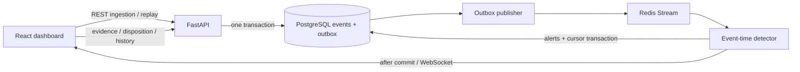

# Architecture and operating semantics

## Persistence

- trading_events: immutable UUID events; Numeric(20,8) prices; timezone-aware
  timestamps; JSONB original metadata; indexes for instrument/time/account/order.
- event_outbox: one unique event reference and publication flag per event. Commit
  with source event. Publish before marking, so crash delivery can duplicate.
- stream_cursor: last processed Redis ID. Commit atomically with detected alerts.
- alerts: unique fingerprint for rule v1 + wash execution pair or spoof order/cancel;
  explainable snapshot with exact evidence IDs and rule score.
- alert_audit_log: immutable actor/status/notes/time records. Status changes lock
  the alert and commit both disposition and history together.
- replay_runs: run UUID, scenario, seed, aware base time, count, creation timestamp.
- detection_state: reserved legacy schema table; the running worker uses stream_cursor.

Schema initialization is versioned by Alembic. SQL initialization and ORM create_all
previously differed; the frozen initial migration and schema.sql now match. Never
initialize with both SQL and Alembic. Existing legacy tables are refused without
mutation so a deliberate data-preserving migration can be prepared.

## Delivery and recovery

The worker acquires a PostgreSQL advisory lock. Unpublished events are retried
when Redis is unavailable; ingestion can still commit while Redis is down after
startup. Duplicate Redis deliveries are expected. Database uniqueness prevents
repeat alerts. A crash before commit reprocesses the message; a crash after commit
and before WebSocket publication is recovered by REST refetch/reconnect. Socket
broadcast is advisory and is not a durable notification protocol.

Redis uses AOF and a named Compose volume. Streams are not trimmed in this slice.
The source database remains authoritative; restoring a lost Redis volume requires
rebuilding the stream from retained events/outbox publication flags as an explicit
operator recovery operation. Do not delete volumes during normal restarts.

A received event anchors a three-minute event-time window centered on its timestamp
(+/-90 seconds). This covers rule contexts for delayed and out-of-order deliveries,
including historical replay and symbols outside any predefined universe. The
entire batch is persisted before any delivery starts. One worker processes stream
messages serially; high-volume partitioning and benchmarks are future work.

## Detection and replay

Wash: opposite executions, <=30 seconds apart, <=1% price difference (relative to
smaller price), <=10% size difference, common explicit beneficial owner. If neither
execution has owner data, matching firm/account is the fallback. Matching firm or
trader alone cannot establish shared beneficial ownership.

Spoof: order >=10,000, cancellation <=15 seconds later, no observed execution of
that order, and same-account opposite executions between placement and cancel.
The rule is a behavioral suspicion heuristic. It does not establish intent, measure
market impact, or incorporate a live order book. Evidence includes the cancellation.

Both rules produce human explanations and ranked evidence scores. Alert evidence
is a first-detection snapshot. Delayed fills or owner corrections can affect an
assessment; no automatic retrospective retraction is implemented. Investigation
requires reviewing the underlying order history and recording a disposition.

Synthetic orders use plausible symbol prices, limit-order/execution/cancellation
lifecycles, venue metadata, and explicit owner identities. The local RNG is seeded;
seed + base_time produce repeatable market data. Each persisted replay gets a new
identity namespace, preventing detections across runs. UUIDs and insertion times
are intentionally unique. Normal replay is a negative control.

## Application scope

Local single-process development deployment, no authenticated identity or role
policy. The initial slice does not implement production retention, regulator feeds,
case exports, rate limits, calibrated model probabilities, or guaranteed throughput.
Health probes check both PostgreSQL and Redis. Background delivery logs failures
and retries persisted work. Do not present a successful health probe as a latency
or freshness guarantee.
