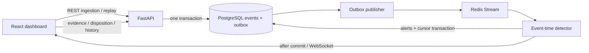
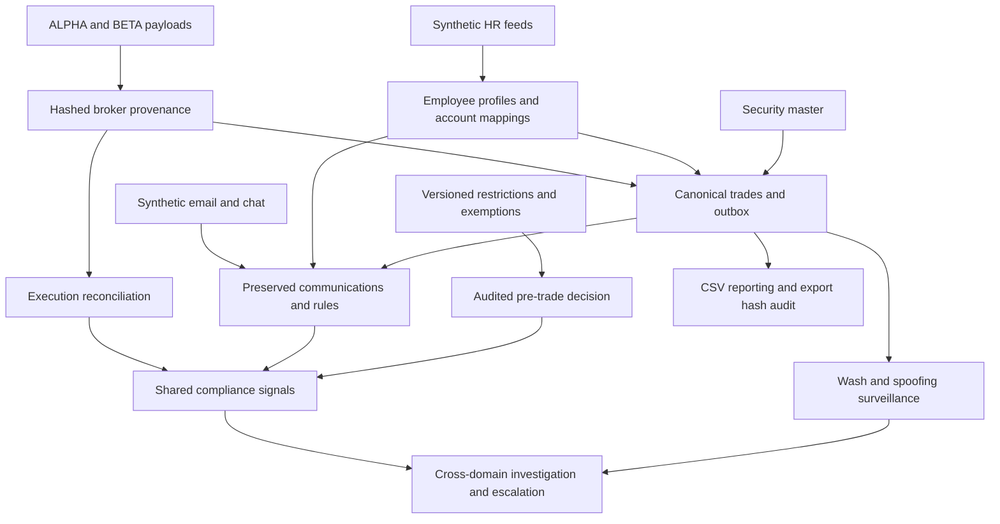

# Architecture and operating semantics

## Persistence

- trading_events: immutable UUID events; Numeric(20,8) prices; timezone-aware
  timestamps; JSONB original metadata; indexes for instrument/time/account/order.
- event_outbox: one unique event reference and publication flag per event. Commit
  with source event. Publish before marking, so crash delivery can duplicate.
- stream_cursor: last processed Redis ID. Commit atomically with detected alerts.
- alerts: unique fingerprint for rule v1 + wash execution pair or spoof order/cancel;
  explainable snapshot with exact evidence IDs and rule score.
- alert_audit_log: immutable actor/status/notes/time records. Status changes lock
  the alert and commit both disposition and history together.
- replay_runs: run UUID, scenario, seed, aware base time, count, creation timestamp.
- detection_state: reserved legacy schema table; the running worker uses stream_cursor.

Schema initialization is versioned by Alembic. SQL initialization and ORM create_all
previously differed; the frozen initial migration and schema.sql now match. Never
initialize with both SQL and Alembic. Existing legacy tables are refused without
mutation so a deliberate data-preserving migration can be prepared.

## Delivery and recovery

The worker acquires a PostgreSQL advisory lock. Unpublished events are retried
when Redis is unavailable; ingestion can still commit while Redis is down after
startup. Duplicate Redis deliveries are expected. Database uniqueness prevents
repeat alerts. A crash before commit reprocesses the message; a crash after commit
and before WebSocket publication is recovered by REST refetch/reconnect. Socket
broadcast is advisory and is not a durable notification protocol.

Redis uses AOF and a named Compose volume. Streams are not trimmed in this slice.
The source database remains authoritative; the authenticated ADMIN recovery endpoint
rebuilds transport from retained events/outbox publication flags. It pauses the worker,
resets the cursor, requeues retained rows and records an operation audit. Do not delete volumes during normal restarts.

A received event anchors a three-minute event-time window centered on its timestamp
(+/-90 seconds). This covers rule contexts for delayed and out-of-order deliveries,
including historical replay and symbols outside any predefined universe. The
entire batch is persisted before any delivery starts. One worker processes stream
messages serially; high-volume partitioning and benchmarks are future work.

## Detection and replay

Wash: opposite executions, <=30 seconds apart, <=1% price difference (relative to
smaller price), <=10% size difference, common explicit beneficial owner. If neither
execution has owner data, matching firm/account is the fallback. Matching firm or
trader alone cannot establish shared beneficial ownership.

Spoof: order >=10,000, cancellation <=15 seconds later, no observed execution of
that order, and same-account opposite executions between placement and cancel.
The rule is a behavioral suspicion heuristic. It does not establish intent, measure
market impact, or incorporate a live order book. Evidence includes the cancellation.

Both rules produce human explanations and ranked evidence scores. Alert evidence
is a first-detection snapshot. Delayed fills or owner corrections can affect an
assessment; no automatic retrospective retraction is implemented. Investigation
requires reviewing the underlying order history and recording a disposition.

Synthetic orders use plausible symbol prices, limit-order/execution/cancellation
lifecycles, venue metadata, and explicit owner identities. The local RNG is seeded;
seed + base_time produce repeatable market data. Each persisted replay gets a new
identity namespace, preventing detections across runs. UUIDs and insertion times
are intentionally unique. Normal replay is a negative control.

## Application scope

Single-process synthetic evaluation deployment with authenticated sessions and
VIEWER/ANALYST/ADMIN roles. The platform does not implement production retention, external regulator feeds,
calibrated model probabilities, or guaranteed throughput.
Health probes check both PostgreSQL and Redis. Background delivery logs failures
and retries persisted work. Do not present a successful health probe as a latency
or freshness guarantee.

## Institutional domains (migration 0002)

Employee profiles are mutable current state, with effective-dated immutable source
changes, source-key idempotency, stale-update protection and account uniqueness.
Trades preserve original source_metadata separately from system-resolved employee
and security enrichment. Forged source claims cannot assign an unresolved employee.
Enrichment is a first-ingestion snapshot; it is not retroactively rewritten when
HR or security master state changes.

Communication ingestion stores canonical fields and original payload with a hash.
Rule evidence contains versioned phrase spans, security mentions, mailbox identity
assurance and exact execution references. Message-first and trade-first correlation
are supported: later trades append pair-keyed TRADE_CORRELATION signals through
the existing Redis worker, rather than altering earlier snapshots. Mailbox identity
is an unverified synthetic feed assertion, not an authenticated sender guarantee.

Restricted policies have versioned immutable decision snapshots and department/time
scope. A newer version retires the former active version; checks produce ALLOW,
BLOCK or REVIEW. Exemptions require unexpired requests and an independent ADMIN
approval. Historical trade ingestion is preserved regardless of pre-trade outcome.

Broker formats normalize independently into the same validated event schema. Each
source record has a content hash and immutable link to its canonical event. Each
record's event/outbox/provenance writes use a savepoint, so malformed peers become
persisted quality issues while valid records commit. Unexpected infrastructure
failures propagate. Source-key locks serialize concurrent imports in PostgreSQL.
Reconciliation compares execution references across brokers and persists missing,
duplicate and mismatched evidence. CSV export audits include filters, version,
row count, requester and SHA256; no regulator-specific filing format is asserted.

Shared signals are unique by domain/rule/fingerprint. Investigations link signal
and trade-alert IDs, validate their existence and append authenticated timelines.
Escalate/close/reopen transitions are explicit and audited. Authentication is stored
in hashed, expiring, revocable sessions; credentials use salted PBKDF2. Cookie
mutation origins and WebSocket origins/session lifetime are checked server-side.

Operational tables persist worker progress/failures, poison-reference retry counts
and quarantine records. Invalid references are quarantined after three retained
attempts; database/connectivity failures never cause cursor advancement. Recovery
uses a local lock and the PostgreSQL worker lock. Health reports dependencies;
operations reports backlog, stream/cursor, freshness and quality issues separately.

The UI provides authenticated overview, employees, communications, trade surveillance,
restrictions, investigations, data/reconciliation, reporting and operations views.
All actions call real APIs; role restrictions are enforced by backend dependencies.
Snowflake analytics is omitted because no real analytics account is configured.
